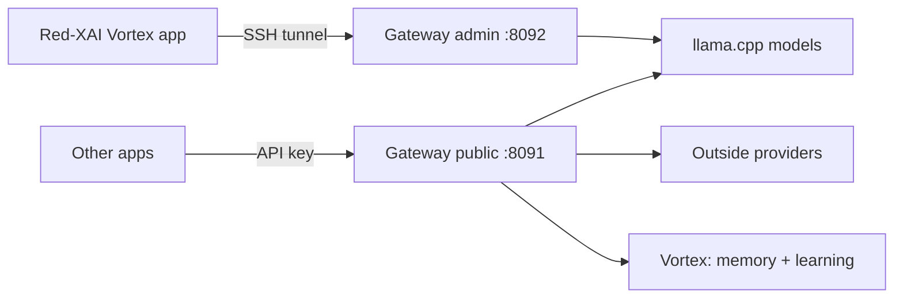

# Red-XAI Vortex: the complete guide

This guide explains everything in plain language. Shorter, more technical pages are linked from each section.

**Contents**
1. [The big picture](#1-the-big-picture)
2. [Models and the Library](#2-models-and-the-library)
3. [Local (your Mac) vs VPS (your server)](#3-local-vs-vps)
4. [Servers, failover, pooling and nodes](#4-servers-failover-pooling-and-nodes)
5. [Merging models](#5-merging-models)
6. [API keys and connecting other apps](#6-api-keys-and-connecting-other-apps)
7. [Outside providers](#7-outside-providers)
8. [Vortex, the learning model](#8-vortex-the-learning-model)
9. [Images and audio](#9-images-and-audio)
10. [PC control (design only)](#10-pc-control-design-only)
11. [Storage overflow](#11-storage-overflow)
12. [Owner vs user permissions](#12-owner-vs-user-permissions)
13. [Troubleshooting](TROUBLESHOOTING.md) and [FAQ](FAQ.md)

---

## 1. The big picture
- **Your server (VPS)** runs the models with llama.cpp. A small program, the **gateway**, sits in front of them and checks API keys.
- **The Mac app (Red-XAI Vortex)** is where you chat, download models, make merges, create keys and teach Vortex. It talks to the server through an **SSH tunnel**, a private encrypted connection that only exists while the app is open.
- **Other apps** (chat clients, IDE plugins, custom GPTs, scripts) use the gateway with **your own API keys**, just like they'd use OpenAI or Ollama.

Nothing on the server listens on the open internet by default. Public access goes through Cloudflare Tunnel or a reverse proxy ([PUBLIC-ACCESS.md](PUBLIC-ACCESS.md)).

## 2. Models and the Library
**Where:** Library, Merges & Keys → **Library**, or **Browse Models** (opens the model browser).

- **Library** lists the curated catalog: good free models for chat, coding, reasoning, vision and embeddings, each with its download size, the RAM it needs and the expected speed.
  - **Download** checks free disk and RAM first, then shows progress.
  - **Uninstall** deletes the file and **frees the disk**. The confirmation shows how much space you get back.
  - **Set Default** chooses the model used when an app doesn't name one.
- **Model browser** is a local web page in your browser, styled like the Ollama library. It shows the whole ollama.com catalogue: search, categories, tags and sizes, a **download target** (this Mac or a server), progress, **Remove** and **Add to Merge**.
  - It only runs on your Mac (127.0.0.1) and needs a one-time token in its link, so other people and websites can't use it. Details: [MODEL-BROWSER.md](MODEL-BROWSER.md).
- **Modelfiles**: make a preset (`FROM`, `SYSTEM`, `PARAMETER`) such as "pirate-coder"; it appears as its own model name.

Which models are good at what (starter set):
| Job | Model |
|---|---|
| General chat | Dolphin Mixtral 8x7B, Dolphin 3 (Llama 3.1 8B / Mistral 24B) |
| Coding | Qwen2.5-Coder 14B |
| Reasoning / maths | DeepSeek-R1-Distill-Qwen 14B |
| Search / memory (embeddings) | nomic-embed-text v1.5 |
On a 16-vCPU server with no GPU, 14B models write about **20 words per second**.

## 3. Local vs VPS
| | **Local (this Mac)** | **VPS (server)** |
|---|---|---|
| Where it runs | llama.cpp with Metal on your Mac's GPU | Your Linux server's CPU (or GPU if it has one) |
| When it runs | **Only while you use it**: it starts when you chat with a local model and stops when idle or when the app quits | Always on |
| Who can use it | Only you, in the app | You and every app with a key |
| Downloads | Anyone can download to their own Mac | **Owner only** |
| Good for | Privacy, offline use, fast replies on Apple Silicon | Sharing with apps, big models, 24/7 |

Choose the target when you download (Library or model browser). Local models show up in the model picker next to server models.

## 4. Servers, failover, pooling and nodes
**Where:** Library, Merges & Keys → **Servers**, and Settings → **Compute**. Details: [POOLING.md](POOLING.md).

- **Servers**: add as many Linux servers as you like (Ubuntu/Debian with SSH key login). **Install / Update** runs the installer over SSH in one click (llama.cpp, gateway, model manager).
- **Per-model target**: each model can live on a different server.
- **Automatic failover**: if the current server stops answering, the app switches to another server, or to this Mac, and tells you.
- **Pooling (nodes)**: a server can borrow another machine's CPU/GPU through llama.cpp **RPC** to run a model that's too big for it alone.
  - *This Mac as a node*: Compute → **Share this Mac's CPU/GPU**. It's **off by default**, turns off when the app quits, and is only reachable through a private SSH tunnel.
  - *A second server as a node* (for example a server in another city such as Atlanta): it runs an RPC worker reachable only over a private tunnel or private network, and the main server adds it to its pool. Pooling over the internet is limited by network speed, so it helps with *fitting* big models more than with *speed*.

## 5. Merging models
Two or three models working as one. See the full guide with diagrams: **[MERGES.md](MERGES.md)**.
- **Router**: one model per message, fast.
- **Draft + Refine**: small drafts, big polishes.
- **Panel + Judge**: several answer, a judge picks. Slowest, but the most careful.

## 6. API keys and connecting other apps
**Where:** Library, Merges & Keys → **API Keys** and **Use in Other Apps**. Details: [CONNECT.md](CONNECT.md), [API.md](API.md).

- **Create Key**: give it a name (the app that will use it). Optionally:
  - **Only allow specific models**;
  - set a requests-per-minute limit;
  - tick **Red-XAI key (redx_xai_…) with scopes**, which adds Vortex abilities (`chat`, `image`, `audio`, `embeddings`, `train:submit`).
- The key is shown **once**. Copy it then; the server only keeps a fingerprint (an HMAC hash), never the key itself.
- The list shows requests, tokens, last used and **Revoke**. Revoking takes effect immediately.
- **Connect:**
  - OpenAI-style apps: base URL `https://YOUR_DOMAIN/v1` + key.
  - Ollama-style apps: base URL `https://YOUR_DOMAIN` + `Authorization: Bearer` header.
  - Custom GPTs: import [openapi-gpt-actions.yaml](openapi-gpt-actions.yaml).

## 7. Outside providers
**Where:** **Providers → Add Provider**. Details: [PROVIDERS.md](PROVIDERS.md).
- Add any OpenAI-compatible service (OpenAI, Groq, OpenRouter, Together, Mistral, Gemini's OpenAI endpoint…) with a base URL, a key and a display name.
- **Test** checks it before saving. The key is **sealed (encrypted) on the server** and never shown again.
- Its models appear as `ext-<provider>-<model>` in every list, can be used with your own keys, and can join merges.

## 8. Vortex, the learning model
**Where:** the **Vortex** tab. Details: [VORTEX.md](VORTEX.md).

Vortex is your own assistant built on open models. Use the model name `vortex`.
- **Memory**: everything in its knowledge store is searched for each message, and the best matches are given to the model. Teach it by pasting text (**Add to knowledge**), with the **crawler**, or with `POST /v1/redxai/ingest`.
- **Preloaded knowledge**: free, openly licensed datasets (Dolly, OpenAssistant, Python docs, Simple English Wikipedia) via `vortex-preload`. Each one can be removed again.
- **Routing**: code goes to the coder model, hard logic to the reasoner, the rest to the main model.
- **Training mode** (off by default): turn it on **and** tick consent. Every reply then gets 👍 👎 and **Correct**. Emails, phone numbers, IPs, card numbers and keys are removed before saving.
- **Learn from the active model**: when the owner switches this on and training mode is on, replies from *whatever model you're chatting with* (or a merge) are saved as lessons. A judge model scores them 1–10, and only the best (8+), plus your 👍 and corrections, are used for training.
- **Crawler**: give it seed URLs. It obeys robots.txt, waits between pages and has a page limit. Sites that block crawlers, or need a login, are skipped.
- **Versions**: real learning means training a small add-on (a LoRA adapter). This **needs a GPU**: export the data, train on a rented GPU for an hour or two, install it, and it becomes `vortex-v1`, `v2`… **Run benchmark** compares versions.

## 9. Images and audio
- `POST /v1/images/generations` (scope `image`): stable-diffusion.cpp with SD-Turbo. About **15 s** for 512×512 on the 16-vCPU server.
- `POST /v1/audio/generations` (scope `audio`): MusicGen-small. About **18 s** for a 5-second clip.
- While an image or song is being made, chat models are unloaded to free RAM, so the next chat takes a little longer to start.
- **Licence warning:** the SD-Turbo and MusicGen weights are **non-commercial**. Swap them for openly licensed models for commercial work.

## 10. PC control (design only)
Not built yet. When it is, it will be a local helper on *your* computer: off by default, asking you before every action, limited to an allowlist, with a kill switch, and never controllable remotely without your local approval. See [PC-CONTROL.md](PC-CONTROL.md).

## 11. Storage overflow
When the server's disk reaches **80%**, old training files are encrypted on the server, uploaded to your storage, checked, and then deleted locally.
- Supported: **S3-compatible** storage (Vultr Object Storage, Cloudflare R2, Backblaze B2, Wasabi) or **WebDAV** (Nextcloud, Synology, Koofr…).
- **TeraBox:** not enabled. Its official API needs an approved developer app; create the account yourself and apply if you want it later.
- **Where:** the Vortex tab → **Overflow storage**: pick a backend, then **Save**, **Test**, **Offload now**. Details: [STORAGE.md](STORAGE.md).

## 12. Owner vs user permissions
See [PERMISSIONS.md](PERMISSIONS.md). In short: the **owner** (the admin key, only over SSH) controls the server. **Users and apps** (their own keys) can only use the models they're allowed to.
