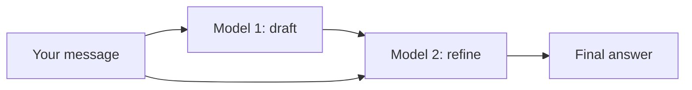
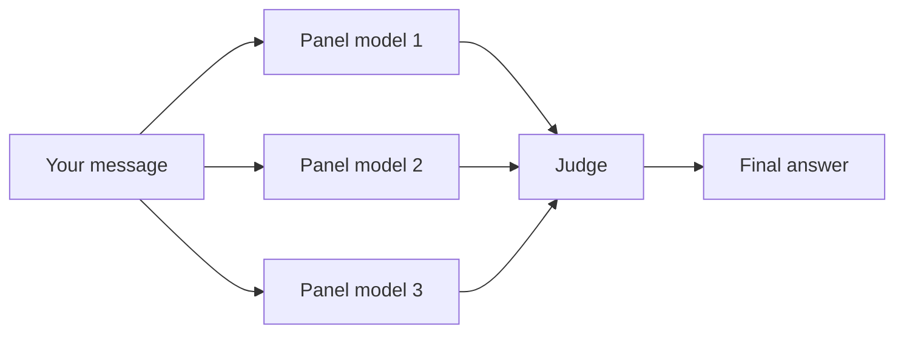
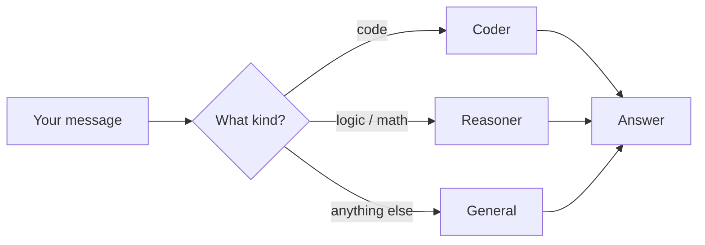

# Merging models

A **merge** makes 2–3 models work together and shows up as one model called `redx-merge-<name>`.
Use it in the app's chat, in other apps through your API key, or inside Vortex.
The models in a merge run **one after another** (not at the same time), so a merge fits in the RAM that one model needs. The cost is time: a merge takes roughly **as long as all its steps added together**.

While a merge is working, the chat shows **"thinking with N models"**, and every reply carries a `redx` section that lists each step, its model and how many seconds it took.

## The three modes

### 1. Draft + Refine (exactly 2 models)
1. Model #1 (the **drafter**, usually small and fast) writes a first answer.
2. Model #2 (the **refiner**, usually bigger and smarter) gets your question **and** the draft and rewrites it into the final answer, fixing mistakes and filling gaps.
3. You see only the refined answer.


**Use it when** you want a big model's quality with less waiting than a full panel, e.g. writing, explanations, emails.
**Speed:** draft time + refine time. Measured: about **11 s** for a short answer and **44 s** for a code answer (3B drafter + 24B refiner).

### 2. Panel + Judge (2–3 models + 1 judge)
1. Each panel model answers your message by itself, one after another.
2. The **judge** model reads every answer and writes the best final answer, either by picking one or by combining their strengths.


**Use it when** being right matters more than speed: tricky questions, code review, decisions, facts you'll rely on.
**Speed:** the slowest option. Every panel answer plus the judge. Measured: about **51 s** (8B + 14B + 14B panel, 24B judge).

### 3. Router (1–3 models)
1. It looks at your message.
2. Code questions go to the coder model (e.g. `qwen2.5-coder-14b`), logic and math to the reasoner (`r1`/`qwq`), and everything else to the general model.
3. **Only one model answers.** If that model fails, the last model in the list answers instead.


**Use it when** you want one "do everything" model that's as fast as a single model.
**Speed:** the same as the model it picks. Measured: about **8 s** (general), **22 s** (reasoner) and **26 s** (coder).

## Which one should I pick?
| You want… | Pick |
|---|---|
| One model for everything, fast | **Router** |
| Better writing from a small + big model pair | **Draft + Refine** |
| The most careful answer, and you can wait about a minute | **Panel + Judge** |

Reasoning models (R1 / QwQ) automatically get at least 2048 tokens so they finish thinking, and their hidden `<think>` text is removed from the answer.

## Walkthrough: making a merge in the app
1. Open **Library, Merges & Keys → Merges**.
2. **"1. Tick up to 3 models"**: the list shows every model, installed or from outside providers. Use **Filter** to search. Tick up to 3. The `#1`, `#2`, `#3` badges show the order (for Draft + Refine, #1 drafts and #2 refines).
3. **"2. Mode and judge"**: choose **Draft + Refine**, **Panel + Judge** or **Router**. For Panel + Judge, pick a **Judge** (a strong model, it can also be one of the panel).
4. Type a **Name** (lowercase letters, numbers, dashes), e.g. `code-panel`.
5. Press **Merge**. It appears under **Merged models** as `redx-merge-code-panel`.
6. Press **Use** to chat with it, or use that name from any other app with your API key. **Remove** deletes the merge (not the models).

The **Merge** button stays grey until the name is valid and you've ticked 1–3 models (exactly 2 for Draft + Refine; 2–3 plus a judge for Panel + Judge).

## By API (owner)
```bash
curl 127.0.0.1:18092/admin/merges -H "Authorization: Bearer $ADMIN_KEY" \
 -d '{"name":"code-panel","mode":"panel_judge","models":["qwen2.5-coder-14b","r1-distill-qwen-14b"],"judge":"dolphin3-mistral-24b-q6k"}'
```
Outside-provider models (`ext-…`) can be drafters, panel members or judges. Merges are limited to 3 models.
All times above were measured on a 16-vCPU / 32 GB CPU server with no GPU.

## Training from merges
When a merge includes **vortex**, the gateway stores the judge-chosen answer as a preferred distill sample and the other members as non-preferred under the same consent rules. Preferred rows export with a rejected alternative for DPO-style training.

## Group merge
Group merge (turning the models in a Group chat into a single merge) is planned for a later update. Until then,
create a merge with the same models under **Library, Merges & Keys → Merges** using *Panel + Judge*.
